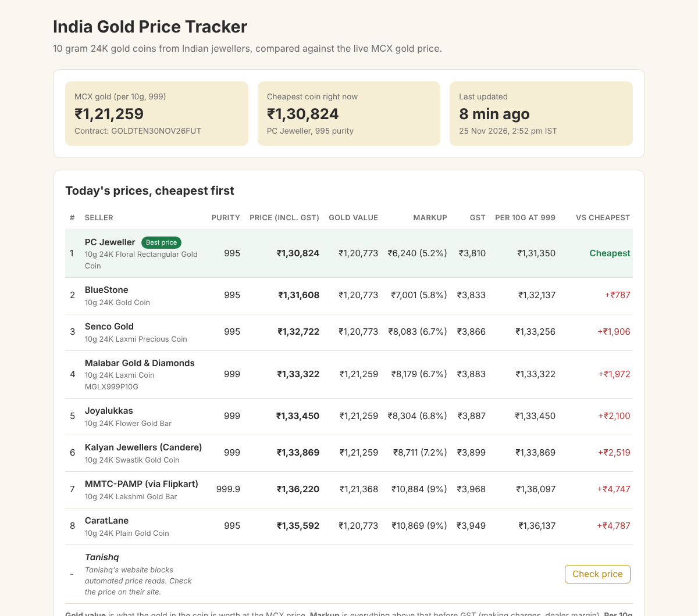

# India Gold Price Tracker

**Live site: [ishurunda12-wq.github.io/gold-tracker](https://ishurunda12-wq.github.io/gold-tracker/)**

Compares the price of a 10 gram 24K gold coin from 9 Indian jewellers against the live MCX gold price, so you can see how much each seller charges above the actual value of the gold.



## What it shows

- The live **MCX Gold Ten** price (per 10g, 999 purity), updated every 30 minutes
- A ranked table of 10g 24K coins and bars, best value first
- For each seller: final price, gold value at MCX, **markup** (making charges and dealer margin), GST, and price per 10g adjusted to 999 purity
- A 1-year gold price chart with 1M, 3M, 6M and 1Y views

**Sellers:** PC Jeweller, BlueStone, Senco Gold, Malabar Gold & Diamonds, Joyalukkas, Kalyan Jewellers (Candere), MMTC-PAMP (via Flipkart), CaratLane. Tanishq is shown as a link only, because its website blocks automated price reads.

## How the numbers work

```
gold value   = MCX price / 10 x weight (g) x purity / 999
GST          = 3% of the final price
markup       = final price - GST - gold value
per 10g, 999 = final price adjusted to 10g of 999 gold, so 995 and 999 coins compare fairly
```

## How it runs

The whole project runs for free, with no server:

1. **cron-job.org** starts the GitHub Actions workflow every 30 minutes.
2. **`scraper.py`** finds the current MCX Gold Ten contract on Groww, reads its live price, reads each seller's price, does the maths, and saves **`prices.json`**.
3. Once a day, **`fetch_history.py`** builds 1 year of prices from the GOLDBEES gold ETF (via yfinance), scaled to MCX, and saves **`gold_history.csv`**.
4. The workflow commits those two files back to the repo.
5. **GitHub Pages** serves **`index.html`**, which reads the two files and draws the page.

**When something fails:** if a seller cannot be read, its last good price is shown for up to 3 hours with a "Price from ... ago" tag. After that it is left out of the table and the workflow emails an alert, once per breakage.

## Files

| File | What it does |
|---|---|
| `index.html` | The web page (HTML, CSS, JavaScript, Chart.js) |
| `scraper.py` | Reads MCX and seller prices, writes `prices.json` |
| `fetch_history.py` | Builds the 1-year history, writes `gold_history.csv` |
| `sellers.csv` | The list of sellers and products tracked |
| `.github/workflows/update-prices.yml` | The automation that runs the scripts |
| `api-notes.md` | Notes on every price source and how it is read |

## Run it yourself

```
python3 -m venv .venv
source .venv/bin/activate
pip install -r requirements.txt
export PCJ_API_KEY=...        # only needed for PC Jeweller
python scraper.py
python fetch_history.py
python3 -m http.server 8000   # then open http://localhost:8000
```

## Notes

- Prices are for information only. Always confirm the final price on the seller's website before buying. Delivery charges and bank offers are not included.
- The 1-year chart is based on the GOLDBEES ETF scaled to MCX, so it is a close guide, not exact MCX closing prices.
- Not affiliated with any of the jewellers listed.

Built by Ishita as a step-by-step learning project in Python, GitHub Actions and web pages.
